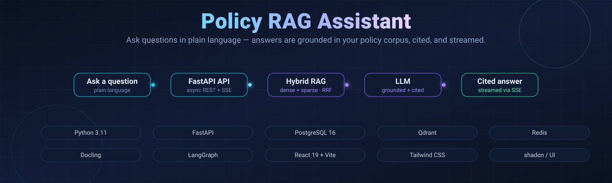
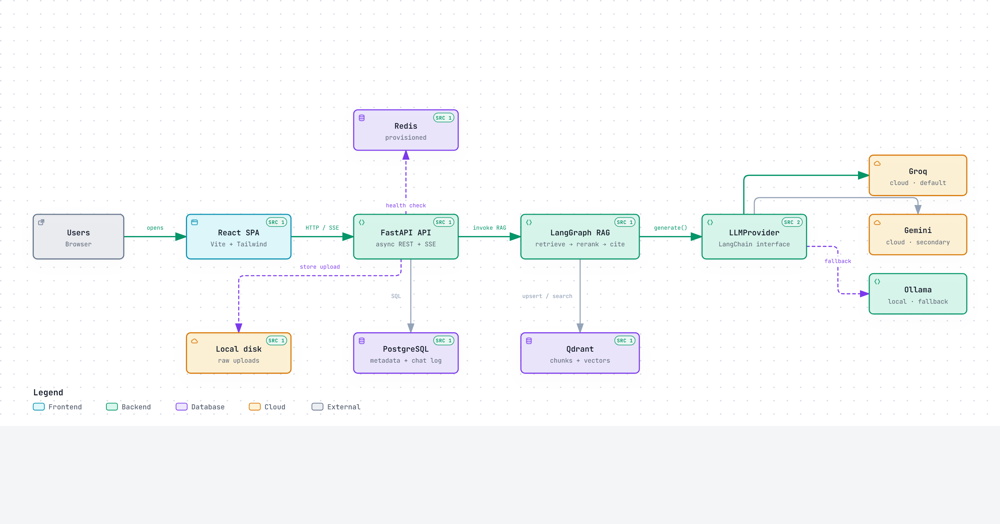
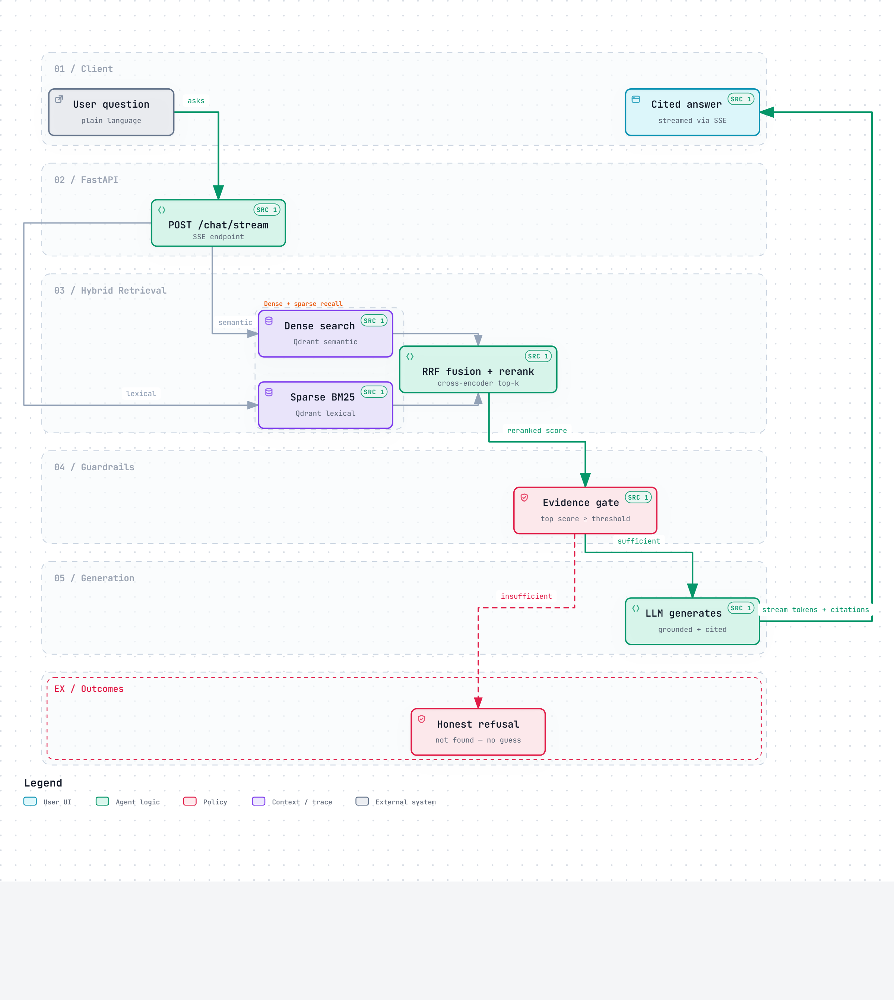

<p align="center">
  
</p>

# Policy RAG Assistant

Ground your LLM answers in your company's policy documents. Ask a question in plain
language and the system retrieves supporting passages with hybrid search, gates the
evidence, and streams back a **cited, verifiable answer** — or an honest refusal when
the documents don't contain the answer.

**Core product rules**

- **Never answers from model memory** — every claim must be traced to a source passage.
- **Always cites its sources** — document, page, and section, with the exact
  `matched_text` highlighted in an Evidence panel.
- **Refuses honestly** — if retrieval supports fail the evidence gate, the system says
  "not found in the documents" instead of guessing.

## Highlights

- **Hybrid retrieval:** dense embeddings (FastEmbed `bge-small-en-v1.5`) and sparse
  BM25 run in parallel over Qdrant, fused with Reciprocal Rank Fusion, then reranked
  by a cross-encoder.
- **Evidence-gated generation:** a LangGraph flow short-circuits with a refusal when
  the top evidence score is below threshold — raw LLM tokens are never streamed
  before the gate passes.
- **Streaming UX:** token + citation events delivered over SSE with a
  validate-then-replay contract and a finite, reader-controlled animated trace in
  the delivered diagrams.
- **Pluggable LLMs:** switch provider via `LLM_PROVIDER` (`groq` default, `gemini`,
  or local `ollama` fallback) without touching the RAG pipeline.
- **Pluggable embeddings:** embedding model + `indexing_model` dimension overrides
  via `backend/.env`, decoupled from the re-embed-replace sync pipeline.

## System architecture

<p align="center">
  
</p>

> Interactive version with **live trace animation**: open
> [`docs/diagrams/architecture.html`](docs/diagrams/architecture.html) in your
> browser (viewer controls: focus nodes, run a route probe, export PNG/SVG).

## Answer pipeline

<p align="center">
  
</p>

> Interactive version: [`docs/diagrams/rag-pipeline.html`](docs/diagrams/rag-pipeline.html)

## How it works

```
Ingest:  Upload → Docling parse → Section chunking → Embed (dense) → Index (Qdrant)
Ask:     Question → Hybrid dense+sparse → RRF fusion → Rerank → Evidence gate → LLM → Cited answer
                                                    └───────── insufficient → Honest refusal
```

1. **Ingestion.** Docling parses PDF, DOCX, XLSX, and CSV into structured elements
   (headings and tables preserved as markdown), chunked **by section** rather than
   fixed window sizes.
2. **Retrieval.** The query is embedded (dense) and tokenized (BM25 sparse). Each
   index returns a ranked list over Qdrant; Reciprocal Rank Fusion merges them.
3. **Rerank.** A cross-encoder rescored to the top-k used for generation.
4. **Evidence gate.** The top score must clear a threshold. If it doesn't, the flow
   takes the refusal branch — **no tokens are emitted**.
5. **Generate.** LangGraph builds a grounded prompt; the LLM answers strictly from the
   provided passages and cites each claim.
6. **Stream.** The answer and its citations stream to the React client over SSE; the
   Evidence panel highlights the exact source spans.

### Retrieval & grounding details

| Stage | Technique | Implementation |
|---|---|---|
| Dense retrieval | semantic vectors | FastEmbed `bge-small-en-v1.5` → Qdrant |
| Sparse retrieval | lexical BM25 | `app/services/bm25.py` → Qdrant sparse vectors |
| Fusion | Reciprocal Rank Fusion | `app/services/retrieval.py` |
| Rerank | cross-encoder | `cross-encoder/ms-marco-MiniLM-L-6-v2` |
| Guardrail | evidence gate + citation verification | `app/services/evidence.py` |
| Orchestration | stateful graph | `app/rag/graph.py` (LangGraph) |

## Tech stack

| Layer | Choice |
|---|---|
| Frontend | React 19 + TypeScript, Vite, Tailwind CSS v4, shadcn/ui, TanStack Query, Zustand |
| API | FastAPI (async), Pydantic v2, SSE streaming |
| Orchestration | LangGraph |
| LLM | Pluggable via LangChain — **Groq** (default), Gemini, Ollama (local fallback), selected by `LLM_PROVIDER` |
| Embeddings | FastEmbed `bge-small-en-v1.5` (dense) + BM25 (sparse) |
| Reranker | Cross-encoder `cross-encoder/ms-marco-MiniLM-L-6-v2` |
| Data | PostgreSQL 16 (metadata + chat log), Qdrant (chunks + vectors), Redis (provisioned) |
| Infrastructure | Docker Compose (Postgres, Qdrant, Redis, backend, frontend) |
| Tooling | `uv` (backend), npm (frontend) |

> When `LLM_PROVIDER` is `groq` or `gemini`, retrieved document content is sent to
> that provider's cloud API as part of the prompt. This is a disclosed change from
> the all-local Ollama baseline — see `project.md` Section 4.1.

## Repository layout

```
policy_rag/
├── backend/             FastAPI app, RAG pipeline, ingestion, migrations
│   └── app/
│       ├── api/         REST + SSE endpoints (chat, documents, health, debug)
│       ├── rag/         LangGraph: graph, state, evidence gate, citations, prompts
│       ├── services/    llm, retrieval, bm25, qdrant, reranker, evidence, documents
│       ├── ingestion/   Docling parser, section chunker, pipeline
│       └── db/          SQLAlchemy models + session
├── frontend/            React + Vite single-page app
│   └── src/
│       ├── components/  layout (three-pane shell), chat, evidence panels
│       ├── hooks/       useChatStream (SSE lifecycle)
│       └── lib/         api.ts networking, sse.ts stream parser
├── docs/                Guides + Archify diagrams (banner.svg, diagrams/)
├── docker-compose.yml   Postgres, Qdrant, Redis, backend, frontend
├── project.md           Single source of truth: scope, stack, schema, UI
└── workflow.md          Agent workflow, build order, conventions
```

`project.md` is the authoritative spec for scope and design decisions; `workflow.md`
governs how work is done. Read both before contributing.

## Frontend

A React 19 + TypeScript single-page app (`frontend/src`) with a three-pane workspace:

- **Left sidebar** (`components/layout/`): workspace groups and the document list, with
  real per-stage ingestion status (Uploading → Parsing → Chunking → Embedding →
  Indexing → Ready) and a dropzone that disables while a document is still processing.
- **Center** (`components/chat/`): the streamed chat thread with citation chips and a
  functional streaming caret; empty, refusal, and cancelled states are all designed.
- **Right** (`components/evidence/`): the Evidence panel, collapsed to zero width by
  default and opened on any citation click to highlight the exact cited passage.

State is split between **Zustand** stores (`stores/`: `workspace`, `conversation`,
`evidence`, `theme`) and **TanStack Query** for server data. Networking lives entirely
in `lib/api.ts` (with a dev-only `VITE_MOCK_API` fixture mode) and SSE parsing in
`lib/sse.ts`; `hooks/useChatStream.ts` owns the stream lifecycle. Both Espresso (dark)
and Ivory (light) themes are implemented via CSS custom properties driven by a
`data-theme` attribute.

## Local development

**Infrastructure** (Postgres, Qdrant, Redis — plus containerized backend/frontend):

```bash
docker compose up -d
```

**Backend** (Python 3.11, run with `uv`):

```bash
cd backend
uv sync
uv run alembic upgrade head
uv run python run.py            # serves on http://localhost:8000
```

On Windows, `backend/scripts/start_server.ps1` wraps this with the required asyncio
selector-loop setup and a health check.

**Frontend** (Node, Vite):

```bash
cd frontend
npm install
npm run dev                     # serves on http://localhost:5173
```

Copy `.env.example` to `.env` in both `backend/` and `frontend/` and fill in the values
(Postgres port is pinned to `5434` to avoid a native-Windows conflict). Secrets such as
`GROQ_API_KEY` / `GOOGLE_API_KEY` go in `.env` only and are never committed.